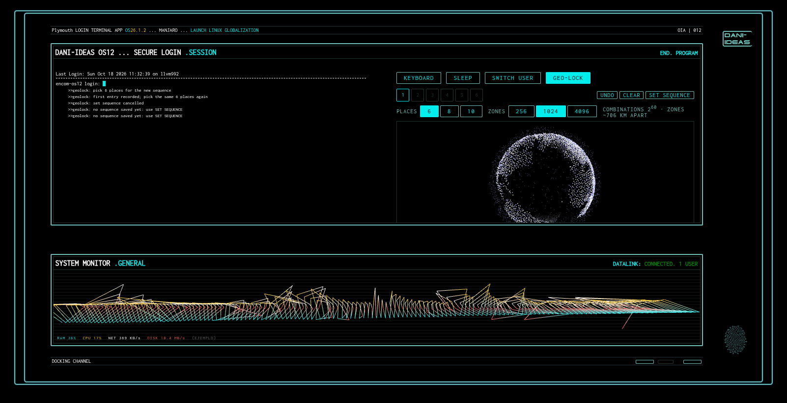

Encom Boardroom — Dani-Ideas fork
=================================

An HTML5 recreation of the [Boardroom
Scene](http://work.gmunk.com/TRON-Board-Room) in Disney's [Tron:
Legacy](http://www.imdb.com/title/tt1104001/), by Robert Scanlon. It displays
realtime data from GitHub and Wikipedia on a simulated ENCOM OS12 interface.
See the original in action at https://www.robscanlon.com/encom-boardroom/ .

This is a fork that modernizes the original and turns its look into a set of
boot/login/lock screens for KDE Plasma. The original credits and the MIT
license are kept below, unchanged.


---

## What's new in this fork

### The boardroom itself, modernized

* **Build:** Grunt + Browserify replaced by [Vite](https://vite.dev/)
  (`npm run build`). Node 20+, Express 5, jQuery 3, Three.js 0.184.
* **Dependencies dropped:** `moment`/`moment-timezone` (now `Intl`),
  `pusher.color`, `jquery-ui` and the `event-source` polyfill, replaced by
  small helpers and native browser APIs.
* **The globe** now comes from the hex-globe fork in `../encom-globe`.
* **Live feeds, revived:** the original 2013 feeds are gone, so GitHub now uses
  the public [events API](https://docs.github.com/en/rest/activity/events) and
  Wikipedia uses Wikimedia [EventStreams](https://stream.wikimedia.org/?doc).
  It works without a server; the optional `stream-server.js` only adds
  locations (see **Feed info**).
* **System monitor:** the "WEBGL .TEST" tube became a live monitor of RAM, CPU,
  network download and disk writes, with the real values when the stream server
  runs and plausible example values otherwise. It's a native C++/Qt scene-graph
  item in the login screens, a Canvas fallback on the web.
* **Login terminal:** the stream selector became a Tron-style terminal that
  takes a login and password, with a virtual keyboard, sleep and switch-user
  buttons, and Caps/Num lock warnings.

### KDE Plasma theme suite

The boardroom look is ported to native **C++/Qt 6 QML** (no browser) and
shipped as the screens you see from power-on to desktop. Each has an
`install-*.sh` and can be previewed before installing:

| Screen | Folder | Installer |
|---|---|---|
| Boot animation (Plymouth) | `plymouth-theme/` | `install-plymouth-theme.sh` |
| Login (SDDM) | `sddm-theme/` | `install-sddm-theme.sh` |
| Splash (while the desktop loads) | `plasma-splash/` | `install-splash.sh` |
| Lock screen | `lockscreen-theme/` | `install-lockscreen.sh` |

The companion particle-globe wallpaper lives in the
[`encom-globe`](https://github.com/arscan/encom-globe) fork
(`plasma-wallpaper-native/`).

The login and lock terminals validate against the real system through PAM; the
SDDM theme has a debug/preview mode that shows exactly what would be sent. See
each folder and the installer header for the details and the recovery steps.

### Geo-lock — proof of concept

`particles-lock.html` and the `GeoLock*` files explore an alternative "password":
a **sequence of places picked on the particle globe**. Each click snaps to the
nearest of a fixed set of zones spread over the sphere, so the ordered sequence
of zones is the secret. The number of places and zones is configurable (e.g. 8
places over 1024 zones ≈ 2⁸⁰ combinations), and the mouse wheel zooms so the
smaller zones stay easy to hit.

In the boardroom login (`index.html`, **GEO-LOCK** button) it runs next to the
password as a second way in. **This is only a simulation to test how the idea
feels:** the sequence is stored as a SHA-256 hash in the browser's
`localStorage`, which protects nothing. Wiring it into the real lock screen
through PAM is a separate, deliberate step, not done by default.



The panel shows the choices live: **PLACES** and **ZONES** set the length and
granularity of the sequence, and the readout (e.g. "COMBINATIONS 2⁶⁰ · ZONES
~706 KM APART" for 6 places over 1024 zones) updates as you change them.

## Usage

```sh
npm install        # encom-globe comes from ../encom-globe (the local hex-globe fork)
npm run build      # vite -> build/encom-boardroom.js and build/encom-boardroom.min.js
```

The page works without a server: serve the directory with any static server
(for example `python3 -m http.server`) and the browser reads the public
Wikipedia and GitHub feeds itself. Opening `index.html` straight from disk also
works in regular browsers, but Qt WebEngine blocks remote requests from
`file://` pages by default.

For locations on the GitHub stream, and IP geolocation for the Wikipedia edits
that still show one, run the stream server:

```sh
GITHUB_TOKEN=<token> PORT=8000 npm start
```

Then point your browser at `http://localhost:8000`. The token only needs public
read access; without it the server still runs, but GitHub events have no
location.

## Notable dependencies

* [Node.js](https://nodejs.org/) 20 or newer, [Vite](https://vite.dev/) and [Express](https://expressjs.com/) 5
* [Three.js](https://threejs.org/) 0.184
* [Encom Globe](https://github.com/arscan/encom-globe), the local fork in `../encom-globe`
* [jQuery](https://jquery.com/) 3
* [pleaserotate.js](https://www.github.com/arscan/pleaserotate.js)
* For the KDE themes: Qt 6, and `qmake6` + `qsb` to build the native plugins

## Feed info

**GitHub:** Events come from GitHub's public [events
API](https://docs.github.com/en/rest/activity/events), which allows 60
unauthenticated requests an hour, so the browser polls it once a minute and
spreads each batch over that minute. With `GITHUB_TOKEN`, the server looks up
each user's profile location and maps it with [OpenStreetMap
Nominatim](https://nominatim.openstreetmap.org/) (at most one request a second,
cached), plus the repository's language and stars. Historic 2013 data was
retrieved from the [GitHub Archive](https://www.gharchive.org/). User pictures
are GitHub avatars.

**Wikipedia:** Edits are streamed in realtime from Wikimedia's
[EventStreams](https://stream.wikimedia.org/?doc) `recentchange` feed (human
edits on the English, Chinese, French, Russian, Spanish, Italian, Portuguese,
Dutch, German, Swedish, Vietnamese and Japanese Wikipedias). Each edit is
placed in the region where its language is mostly spoken. Most wikis now give
anonymous editors temporary accounts instead of showing their IP; for the edits
that still show one, the server maps it with [ip-api.com](https://ip-api.com/).

## Not affiliated

This project is not associated with GitHub, Wikipedia, Tron: Legacy, or Disney.
It is just a tribute. The original author's note follows.

> While I attempted to stay true to the film, it simply wasn't practical to
> recreate every element that is portrayed in the scene. The graphics displayed
> in the film contain a remarkable amount of detail despite only being visible
> for a couple of seconds. I am in awe of those that put it together.
>
> My focus was on the globe and I made it available as a [standalone
> library](https://github.com/arscan/encom-globe) for those interested. The
> other elements are only loose adaptations of the film version.

## License

The MIT License (MIT)

Copyright (c) 2014-2017 Robert Scanlon (original work)
Copyright (c) 2026 Dani-Ideas (fork: modernization, KDE themes, geo-lock)

Permission is hereby granted, free of charge, to any person obtaining a copy
of this software and associated documentation files (the "Software"), to deal
in the Software without restriction, including without limitation the rights
to use, copy, modify, merge, publish, distribute, sublicense, and/or sell
copies of the Software, and to permit persons to whom the Software is
furnished to do so, subject to the following conditions:

The above copyright notice and this permission notice shall be included in
all copies or substantial portions of the Software.

THE SOFTWARE IS PROVIDED "AS IS", WITHOUT WARRANTY OF ANY KIND, EXPRESS OR
IMPLIED, INCLUDING BUT NOT LIMITED TO THE WARRANTIES OF MERCHANTABILITY,
FITNESS FOR A PARTICULAR PURPOSE AND NONINFRINGEMENT. IN NO EVENT SHALL THE
AUTHORS OR COPYRIGHT HOLDERS BE LIABLE FOR ANY CLAIM, DAMAGES OR OTHER
LIABILITY, WHETHER IN AN ACTION OF CONTRACT, TORT OR OTHERWISE, ARISING FROM,
OUT OF OR IN CONNECTION WITH THE SOFTWARE OR THE USE OR OTHER DEALINGS IN
THE SOFTWARE.
